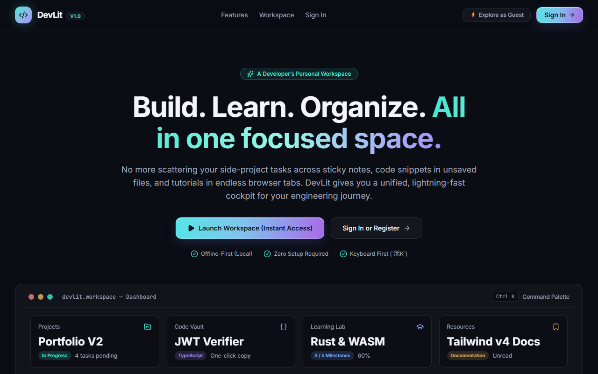

# Vict Christine De Asis — Frontend Developer Portfolio

> A responsive, editorial-inspired developer portfolio built with **React 19**, **TypeScript**, **Vite**, and **GSAP**. Designed to showcase featured web applications, frontend engineering fundamentals, and thoughtful user interfaces.



---

## 🌟 Overview

This repository houses the personal frontend developer portfolio of **Vict Christine De Asis**, a fourth-year BSIT student and aspiring entry-level frontend engineer based in Digos City, Philippines.

The portfolio is designed with an editorial aesthetic, blending classical typography with modern frontend performance, subtle animations, and high usability.

---

## 🚀 Key Features

- **Component-Based Architecture**: Modular, maintainable React components (`Hero`, `About`, `Work`, `ProjectCard`, `Contact`, `Navbar`, `Marquee`, `Footer`, `Icon`).
- **Interactive GSAP Animations**:
  - Hero staggered entrance timeline with `useGSAP`.
  - ScrollTrigger-driven reveal animations on section headings and project cards.
  - Infinite continuous ticker marquee with dynamic scroll velocity boost and interactive hover-pause.
  - Full support for `prefers-reduced-motion` accessibility settings.
- **Mobile-First & Fully Responsive**: Built from the ground up for mobile screens (`0px - 639px`), progressively enhanced for tablet (`640px+`) and desktop (`1024px+`) viewports.
- **Unified Plain CSS Architecture**: Clean CSS custom properties (design tokens) establishing consistent rhythm, spacing, and an editorial palette (`plum`, `cream`, `yellow`, `lilac`, `sage`, `clay`).
- **Interactive Contact Section**:
  - Direct **Gmail Web Compose** integration with pre-filled subject and message body.
  - Native **Default Mail App** (`mailto:`) option.
  - One-click email copy button with instant feedback.
- **React Router Foundation**: Structured with `react-router-dom` to support future multi-page expansion and safe wildcard route redirection.

---

## 💻 Featured Projects

| Project | Live Demo | Repository | Description | Tech Stack |
|---|---|---|---|---|
| **BaonWise** | [Live App](https://baonwise.vercel.app/) | [GitHub](https://github.com/vcrstn/BaonWise) | Student allowance and expense tracker with a *"Can I Afford This?"* reality checker, budget planner, and spending insights. | React, TypeScript, Tailwind CSS, Vite |
| **DevLit** | [Live App](https://devlit-sigma.vercel.app/) | [GitHub](https://github.com/vcrstn/devlit) | Developer workspace dashboard to track active side projects, code snippets, learning goals, and curated documentation. | React, TypeScript, Tailwind CSS, Vite |
| **FollowThru** | [Live App](https://followthru-one.vercel.app/) | [GitHub](https://github.com/vcrstn/followthru) | Mindful habit and task tracker focused on overcoming friction by choosing one task at a time and taking steady, actionable steps. | React, TypeScript, Tailwind CSS, Vite |

---

## 🛠️ Tech Stack & Libraries

- **Framework**: [React 19](https://react.dev/)
- **Build Tool**: [Vite 8](https://vitejs.dev/)
- **Language**: [TypeScript](https://www.typescriptlang.org/)
- **Routing**: [React Router v7](https://reactrouter.com/)
- **Motion & Animations**: [GSAP 3](https://gsap.com/) & [@gsap/react](https://gsap.com/resources/React/)
- **Styles**: Plain CSS with CSS Custom Properties (Design Tokens)
- **Typography**: [Fraunces](https://fonts.google.com/specimen/Fraunces), [DM Mono](https://fonts.google.com/specimen/DM+Mono), [Manrope](https://fonts.google.com/specimen/Manrope)

---

## 📂 Project Structure

```text
Portfolio/
├── public/
│   ├── projects/               # High-res screenshots of deployed web apps
│   │   ├── baonwise.png
│   │   ├── devlit.png
│   │   └── followthru.png
│   ├── leaf-corner.png         # Sage-green botanical corner accent
│   ├── profile-portrait.jpg    # Hero profile photo
│   └── favicon.svg
├── src/
│   ├── components/             # Reusable modular UI components
│   │   ├── About.tsx
│   │   ├── Contact.tsx         # Employer contact form with Gmail integration
│   │   ├── Footer.tsx
│   │   ├── Hero.tsx            # Hero section & framed portrait card
│   │   ├── Icon.tsx            # Inline SVG icon system
│   │   ├── Marquee.tsx         # GSAP-animated infinite ticker
│   │   ├── Navbar.tsx          # Responsive navigation bar
│   │   ├── ProjectCard.tsx     # Dynamic project display cards
│   │   └── Work.tsx            # Selected projects container
│   ├── data/
│   │   └── portfolioData.ts    # Centralized data model for profile & projects
│   ├── pages/
│   │   └── Home.tsx            # Page wrapper with GSAP ScrollTrigger setup
│   ├── App.tsx                 # React Router configuration
│   ├── index.css               # Mobile-first stylesheet with design tokens
│   └── main.tsx                # Application entry point
├── package.json
├── tsconfig.json
└── vite.config.ts
```

---

## ⚡ Getting Started

### Prerequisites

Ensure you have [Node.js](https://nodejs.org/) installed (v18 or higher recommended).

### Installation

1. Clone the repository:
   ```bash
   git clone https://github.com/vcrstn/portfolio.git
   cd portfolio
   ```

2. Install dependencies:
   ```bash
   npm install
   ```

3. Start the development server:
   ```bash
   npm run dev
   ```

4. Open your browser and navigate to `http://localhost:5173`.

### Production Build

To generate the optimized production build:

```bash
npm run build
```

Preview the production build locally:

```bash
npm run preview
```

---

## 📬 Contact & Connect

- **Email**: [victchristinedeasis@gmail.com](mailto:victchristinedeasis@gmail.com)
- **LinkedIn**: [Vict Christine De Asis](https://www.linkedin.com/in/vict-christine-de-asis-a858b2427)
- **GitHub**: [@vcrstn](https://github.com/vcrstn)

---

© 2026 Vict Christine De Asis. Designed & built with care.
